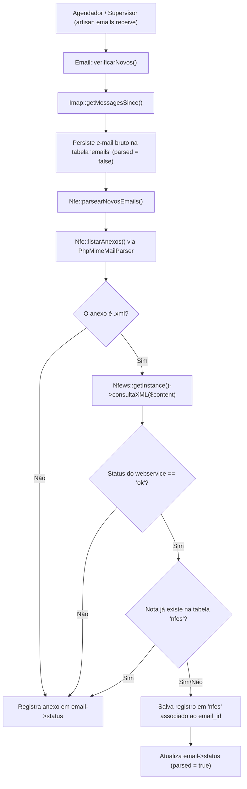

# Especificações Técnicas e Diretrizes do Projeto: repositorio-nfe

Este documento fornece as especificações atuais, arquitetura, fluxo de dados e convenções do projeto **repositorio-nfe** para guiar agentes de IA e desenvolvedores.

---

## 1. Visão Geral

O **repositorio-nfe** é uma aplicação web em Laravel desenvolvida para receber, validar, armazenar e gerenciar Notas Fiscais Eletrônicas (NF-e) recebidas por e-mail, atendendo às demandas de conferência fiscal e prestação de contas da Universidade de São Paulo (USP / EESC).

### Principais Funcionalidades:
* **Ingestão Automática via IMAP:** Monitoramento contínuo de caixas postais para captura de e-mails com anexos de NF-e.
* **Extração e Parsing de Anexos:** Separação do cabeçalho, corpo e anexos MIME, filtrando arquivos XML de notas fiscais.
* **Validação e Consulta SEFAZ:** Integração com o webservice [`nfe-ws`](../nfe-ws) via biblioteca [`uspdev/nfe-ws-consumer`](https://github.com/uspdev/nfe-ws-consumer) para validação estrutural contra schemas e consulta à SEFAZ em tempo real.
* **Repositório Centralizado:** Armazenamento seguro do XML, dados fiscais estruturados (emitente, destinatário, valores, protocolo) e histórico de consultas.
* **Disponibilização de Documentos:** Download do XML original, DANFE em PDF e relatório de consulta/protocolo SEFAZ em PDF.
* **Autenticação Institucional:** Controle de acesso via Senha Única USP ([`uspdev/senhaunica-socialite`](https://github.com/uspdev/senhaunica-socialite)) com controle de permissões por papéis (`admin`, `manager`, `user`).
* **Interface Visual e Integração Corporativa:** Padrão visual USP via [`uspdev/laravel-usp-theme`](https://github.com/uspdev/laravel-usp-theme) e integração com a base corporativa via [`uspdev/laravel-replicado`](https://github.com/uspdev/laravel-replicado).

---

## 2. Stack Tecnológica

* **Framework Web:** [Laravel 11.x](https://laravel.com/) (`laravel/framework: ^11.0`)
* **Linguagem:** PHP ^8.2 (compatível com PHP 8.2 e 8.3)
* **Manipulação de E-mails e Protocolos:**
  * `php-imap/php-imap` (`^5.0`): Conexão IMAP / SSL com caixas postais (requer extensão PHP `imap` ou sockets).
  * `php-mime-mail-parser/php-mime-mail-parser` (`^7.1`): Parser MIME para desmembrar mensagens e extrair anexos (requer extensão PHP `mailparse`).
* **Consumo do Webservice NF-e:**
  * `uspdev/nfe-ws-consumer` (`^0.3`): Cliente HTTP REST para envio de XML e obtenção de DANFE/relatórios do `nfe-ws`.
* **Pacotes do Ecossistema USPDev:**
  * `uspdev/senhaunica-socialite` (`^4.3`): Autenticação OAuth Senha Única USP e gestão de permissões.
  * `uspdev/laravel-usp-theme` (`^2.8`): Tema responsivo Bootstrap integrado aos padrões de identidade visual da USP.
  * `uspdev/laravel-replicado` (`^1`): Abstração de consultas à base corporativa Replicado USP.
  * `uspdev/laravel-tools` (`^1`): Ferramentas administrativas (backup, visualização de logs, diagnóstico de ambiente).
  * `uspdev/utils` (`^1.1`): Utilitários gerais para sanitização e máscaras.
* **Banco de Dados:**
  * SQLite (`storage/database.sqlite`) para desenvolvimento local.
  * MySQL / MariaDB para produção (compatível com colunas do tipo `JSON`).
* **Testes Automatizados:** [PHPUnit 10](https://phpunit.de/) (`phpunit/phpunit: ^10.5`).
* **Processos em Segundo Plano:**
  * [Supervisor](http://supervisord.org/) para execução contínua do comando `artisan emails:receive`.
  * Laravel Task Scheduling (`schedule:run`) via Cron do sistema.

---

## 3. Estrutura de Diretórios e Arquivos

```text
repositorio-nfe/
├── app/
│   ├── Console/
│   │   └── Kernel.php             # Agendamento de tarefas (schedule do emails:receive)
│   ├── Exceptions/
│   │   └── Handler.php            # Tratamento centralizado de exceções
│   ├── Http/
│   │   ├── Controllers/
│   │   │   ├── Controller.php     # Base controller
│   │   │   ├── EmailController.php# Gerenciamento de e-mails, disparo manual e listagem
│   │   │   └── NfeController.php  # Listagem, estatísticas e streaming de downloads (XML, DANFE, SEFAZ)
│   │   ├── Middleware/            # Middlewares HTTP padrão do Laravel e autenticação
│   │   ├── Requests/              # Form Requests de validação
│   │   └── Kernel.php             # Configuração dos pipelines de middlewares HTTP
│   ├── Models/
│   │   ├── Email.php              # Modelo Eloquent e lógica de ingestão IMAP
│   │   ├── Nfe.php                # Modelo Eloquent, parsing de anexos e persistência de NF-e
│   │   └── User.php               # Modelo de usuário autenticado via Senha Única
│   ├── Policies/
│   │   ├── EmailPolicy.php        # Políticas de autorização para o modelo Email
│   │   └── NfePolicy.php          # Políticas de autorização para o modelo Nfe
│   ├── Services/
│   │   ├── Imap.php               # Singleton de conexão IMAP e busca de mensagens não lidas
│   │   └── Nfews.php              # Singleton do cliente NfeWsConsumer para o webservice nfe-ws
│   ├── Providers/                 # Service Providers da aplicação e pacotes
│   └── helpers.php                # Funções utilitárias globais (formatarCnpjCpf, formatarDataNfe)
├── config/
│   ├── nfe.php                    # Configuração de conexão com o webservice nfe-ws
│   ├── imap.php                   # Credenciais e parâmetros de conexão IMAP
│   ├── senhaunica.php             # Parâmetros OAuth do Senha Única USP
│   └── replicado.php              # Configuração de conexão à base corporativa Replicado
├── database/
│   ├── migrations/                # Migrações do banco de dados (emails, nfes, users, permissões)
│   ├── factories/                 # Model factories para testes
│   └── seeders/                   # Seeders de inicialização
├── resources/
│   └── views/
│       ├── emails/                # Telas de listagem e detalhes dos e-mails recebidos
│       │   └── index.blade.php
│       ├── nfes/                  # Telas de listagem de notas, estatísticas e filtros
│       │   ├── index.blade.php
│       │   ├── estatisticas.blade.php
│       │   └── partials/          # Partials de botões de download e filtros por ano
│       ├── layouts/
│       │   └── app.blade.php      # Layout principal herdando do laravel-usp-theme
│       ├── index.blade.php        # Página inicial pública
│       └── nfews-status.blade.php # Diagnóstico visual do status do webservice nfe-ws
├── routes/
│   ├── web.php                    # Rotas web (autenticadas via gates admin/manager)
│   ├── console.php                # Definição do comando 'emails:receive'
│   └── api.php                    # Endpoints de API (protegidos via Sanctum)
├── storage/
│   ├── logs/                      # Logs de execução (emails-receive.log, laravel.log)
│   └── database.sqlite            # Banco de dados local padrão
├── tests/
│   ├── Feature/                   # Testes de integração HTTP
│   └── Unit/                      # Testes unitários
├── .env.example                   # Modelo completo de variáveis de ambiente
├── artisan                        # CLI do Laravel
├── composer.json                  # Dependências PHP e scripts de ciclo de vida
└── phpunit.xml                    # Configuração da suíte de testes do PHPUnit
```

---

## 4. Modelagem de Dados e Fluxo do Negócio

### Principais Entidades:

#### 1. `emails` ([`app/Models/Email.php`](app/Models/Email.php))
Armazena os metadados brutos dos e-mails capturados da caixa postal:
* `id`: Identificador primário autoincrementável.
* `message_id`: Cabeçalho `Message-ID` do e-mail para rastreabilidade.
* `date`: Data de envio do e-mail (`datetime`).
* `subject`: Assunto da mensagem.
* `to` / `from`: Remetente e destinatários.
* `raw_header`: Cabeçalhos brutos da mensagem.
* `raw_body`: Corpo bruto do e-mail.
* `status`: Array/JSON estruturado contendo:
  * `parsed`: Booleano indicando se o e-mail já teve seus anexos processados.
  * `parsedate`: Timestamp da execução do parser.
  * `attachments`: Lista com nome, tamanho, tipo MIME e status de consulta de cada anexo.
* `unidade`: Código ou identificador da unidade receptora.

#### 2. `nfes` ([`app/Models/Nfe.php`](app/Models/Nfe.php))
Armazena as notas fiscais validadas e aprovadas:
* `chave`: Chave de acesso de 44 dígitos da NF-e (`decimal(44,0)`).
* `xml`: Conteúdo completo do arquivo XML (`longText`).
* `prot`: JSON com os dados do protocolo de autorização SEFAZ.
* `emit`: JSON com os dados do emitente (CNPJ/CPF, razão social, endereço).
* `dest`: JSON com os dados do destinatário.
* `ide`: JSON com os dados de identificação da nota (número, série, data de emissão).
* `consulta`: JSON com o resultado retornado pelo webservice `nfe-ws` na consulta SEFAZ.
* `infadic`: Informações adicionais de interesse do fisco ou contribuinte.
* `unidade`: Identificador da unidade destinatária.
* `ano`: Ano da emissão da nota fiscal (utilizado para agrupamento e filtros).
* `email_id`: Chave estrangeira referenciando o e-mail de origem em `emails.id`.

---

### Fluxo de Processamento de Notas:



---

## 5. Rotas, Permissões e Endpoints

O acesso às rotas web é protegido por autenticação OAuth da Senha Única USP e segmentado por *Gates* de autorização:

### Rotas Públicas:
* `GET /`: Página inicial com apresentação do sistema e links de login.
* `GET /login`: Redirecionamento para o fluxo OAuth da Senha Única.
* `GET /callback`: Retorno e validação do token OAuth.
* `POST /logout`: Encerramento da sessão autenticada.

### Rotas de Gerente (`can:manager`):
* `GET /nfews-status`: Painel de visualização da saúde e certificado digital do webservice `nfe-ws`.
* `GET /nfes`: Listagem de notas fiscais com filtros por ano e paginação (`NfeController@index`).
* `GET /nfes/{nfe}`: Visualização detalhada dos dados fiscais da nota (`NfeController@show`).
* `GET /nfes/{nfe}/xml`: Download do arquivo XML original assinado (`NfeController@xmlDownload`).
* `GET /nfes/{nfe}/danfe`: Download do DANFE em formato PDF gerado pelo webservice (`NfeController@danfeDownload`).
* `GET /nfes/{nfe}/sefaz`: Download do relatório SEFAZ em formato PDF gerado pelo webservice (`NfeController@sefazDownload`).

### Rotas de Administrador (`can:admin`):
* `GET /emails`: Listagem paginada dos e-mails capturados na caixa postal (`EmailController@index`).
* `GET /emails/verificarNovos`: Disparo manual síncrono para verificar novos e-mails via IMAP (`EmailController@verificarNovos`).
* `GET /emails/{email}/parse`: Reprocessamento manual dos anexos de um e-mail específico (`EmailController@parse`).
* `GET /estatisticas`: Dashboard com métricas de notas processadas por período e emitente (`NfeController@estatisticas`).
* Rotas administrativas do pacote `uspdev/laravel-tools` (backup, consulta de logs e bibliotecas).

### Rotas de Console (Artisan):
* `php artisan emails:receive`: Rotina principal que aciona `Email::verificarNovos()` e `Nfe::parsearNovosEmails()`, registrando o resultado no canal de log `imapCron`.

---

## 6. Configuração e Variáveis de Ambiente (`.env`)

A aplicação requer configuração dos seguintes blocos essenciais no arquivo `.env`:

### 1. Conexão com o Webservice `nfe-ws`:
```env
# URL base do webservice nfe-ws
NFE_WS_SERVER=https://nfe.sua-unidade.usp.br/api

# Credencial de acesso (API Key)
NFE_WS_API_KEY=sua_api_key_de_64_caracteres_hex
#NFE_WS_DEBUG=0
#NFE_WS_SSL_VERIFY=true
```

### 2. Caixa Postal IMAP:
```env
IMAP_HOST=imap.gmail.com
IMAP_PORT=993
IMAP_ENCRYPTION=ssl
IMAP_PROTOCOL=imap
IMAP_VALIDATE_CERT=true
IMAP_USERNAME=nfe-recebidas@sua-unidade.usp.br
IMAP_PASSWORD=sua_senha_de_aplicativo_gerada_no_google
```

### 3. Autenticação Senha Única USP:
```env
SENHAUNICA_KEY=sua_chave_oauth
SENHAUNICA_SECRET=seu_segredo_oauth
SENHAUNICA_CALLBACK_ID=seu_callback_id

# Números USP com perfil administrativo (separados por vírgula)
SENHAUNICA_ADMINS=111111,222222

# Números USP com perfil de gerência/consulta (separados por vírgula)
SENHAUNICA_GERENTES=333333,444444

# Código da unidade gestora
SENHAUNICA_CODIGO_UNIDADE=18
```

### 4. Base Corporativa Replicado USP:
```env
REPLICADO_HOST=seu_host_replicado
REPLICADO_PORT=1433
REPLICADO_DATABASE=replicado
REPLICADO_USERNAME=seu_usuario
REPLICADO_PASSWORD=sua_senha
REPLICADO_CODUNDCLG=18
```

---

## 7. Comandos e Operação

### Instalação Inicial:
```bash
# Instalação das dependências PHP
composer install

# Configuração do ambiente
cp .env.example .env
php artisan key:generate

# Execução das migrações do banco de dados
php artisan migrate
```

### Execução em Desenvolvimento:
```bash
# Inicialização do servidor embutido
php artisan serve

# Execução manual da captura de e-mails
php artisan emails:receive

# Teste do agendador
php artisan schedule:work
```

### Execução em Produção com Supervisor:
Recomenda-se manter o processo rodando via Supervisor em `/etc/supervisor/conf.d/repositorio-nfe.conf`:
```ini
[program:repositorio-nfe-imap-idle]
command=/usr/bin/php /caminho/para/repositorio-nfe/artisan emails:receive
process_name=%(program_name)s
priority=999
autostart=true
autorestart=unexpected
startretries=3
stopsignal=QUIT
stdout_logfile=/caminho/para/repositorio-nfe/storage/logs/supervisor-imap-stdout.log
stderr_logfile=/caminho/para/repositorio-nfe/storage/logs/supervisor-imap-stderr.log
```

---

## 8. Diretrizes para Agentes de IA

1. **Separação entre Repositório e Emissão Fiscal:**
   * O `repositorio-nfe` **não assina XMLs nem fala diretamente com a SEFAZ via SOAP**. Toda interação com a SEFAZ (consulta, DANFE, validação de certificado) deve ser delegada exclusivamente ao webservice `nfe-ws` através do singleton [`App\Services\Nfews`](app/Services/Nfews.php).
2. **Idempotência e Segurança na Ingestão:**
   * Nunca persista notas em duplicidade: verifique sempre a existência prévia da chave com `Nfe::where('chave', $chave)->exists()`.
   * Atualize o campo `status->parsed` do e-mail somente após concluir a extração e salvar os registros para evitar perda de anexos em falhas transitórias.
3. **Tratamento de Anexos e Memória:**
   * O parsing de e-mails pode lidar com mensagens contendo múltiplos anexos pesados. Evite carregar corpos brutos de mensagens em massa para a memória em queries de listagem (utilize `select([...])` estrito).
4. **Permissões e Segurança de Arquivos:**
   * O download de arquivos (`xmlDownload`, `danfeDownload`, `sefazDownload`) é feito via *streaming* (`response()->streamDownload()`) a partir do banco de dados ou da chamada da API remota, garantindo que usuários não autorizados não acessem caminhos físicos em disco.
   * Respeite os gates `can:manager` e `can:admin` em qualquer novo endpoint implementado.
5. **Compatibilidade com o Ecossistema USPDev:**
   * Utilize as convenções dos pacotes oficiais da USP (`UspTheme`, `SenhaunicaSocialite`, `Replicado`) e siga as diretrizes PSR-12 para código PHP.
